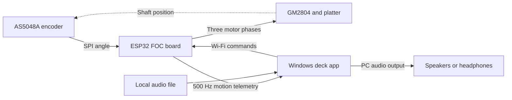

# PlatterDeck

A motorised DJ platter built from an ESP32 FOC board, a GM2804 gimbal motor
and an AS5048A magnetic encoder. The board sends platter motion over Wi-Fi
to a Windows app that plays and scratches local audio files.

The first hardware version is working. This repository contains the firmware,
Windows application, calibration tools and build documentation for that prototype.

Repository: [nzwildcode/esp-foc-platter-deck](https://github.com/nzwildcode/esp-foc-platter-deck).

## What it does

- **STEADY:** plays from the audio clock at the selected tempo.
- **VINYL:** follows the platter, including stopping and reversing by hand.
- 33 1/3 and 45 rpm, pitch control, cue points, waveform and adjustable start/brake.
- Local motor control with SimpleFOC and per-motor cogging compensation.
- Browser dashboard for setup, calibration and firmware updates.
- Simulator mode for trying the Windows app without hardware.

One deck, Windows 10/11, no mixer. Wi-Fi carries commands and encoder
telemetry; the PC generates the audio. This controls digital audio files;
it does not read grooves from a vinyl record.

## Start here

| Document | Contents |
|---|---|
| [Setup guide](docs/getting-started.md) | Build, first USB flash, calibration and playback |
| [Hardware and wiring](hardware/README.md) | Parts, connection diagram and exact GPIO mapping |
| [BOM spreadsheet](hardware/BOM.csv) | Quantities, specifications and details still to confirm |
| [Firmware](PlatterDeck_FOC/README.md) | Motor control, dashboard and UDP protocol |
| [Windows app](platterdeck_windows_GUI-RUST/README.md) | Controls, Rust build and diagnostics |
| [Release checklist](docs/release-checklist.md) | Verification and remaining release work |
| [Publication plan and drafts](docs/publication.md) | Elektor Labs pitch and short Reddit post |

After building the Windows app using the setup guide, try it without a board:

```powershell
.\platterdeck_windows_GUI-RUST\target\release\platterdeck.exe --sim
```

This is a source-only publication. Build the app and firmware using the setup guide.

For hardware use, follow the [setup guide](docs/getting-started.md).
A new board needs a USB/serial flash before its web dashboard is available.
The firmware build produces an application `firmware.bin` for updates,
not a complete blank-flash image.

## Hardware

| Part | Baseline |
|---|---|
| Controller | ESP32-WROOM-32E FOC_ESP32 / 303FOCESP01 / LCT-279 board |
| Motor | iPower GM2804, 7 pole pairs |
| Encoder | AS5048A, 14-bit SPI, with matching shaft magnet |
| Power | 12 V DC; actual supply current rating still to document |
| Host | Windows PC with Wi-Fi and audio output |

The [BOM](hardware/BOM.csv) also covers the platter, mount, fasteners,
cabling and programming interface. Supplier links, prices and the working
platter's dimensions still need confirmation. Frame CAD drafts are not yet
verified against the physical assembly and are not part of the v1 build instructions.

## How it works



Motor control runs locally on the ESP32. More than 500 ms without an accepted
deck command disables the bridge. Cogging compensation is identified for the
individual assembly and stored on the board. VINYL mode uses a 160 ms velocity
fit during free rotation and a 24 ms fit during hand movement.

## Performance notes

Earlier project notes report about 1.3 rpm RMS speed ripple at 33 1/3 rpm
(0.61 rpm RMS using 20 ms windows), and 0.28% RMS variation in the VINYL
audio playback rate after compensation. These are prototype observations;
the raw captures are not included in this release. The audio-rate result
is not a standardised acoustic wow-and-flutter measurement.

The engine's Wi-Fi playback delay is configured to 40 ms. Actual motion-to-sound
latency also depends on the audio device and buffering and still needs a
documented end-to-end measurement for the article.

## Source and licence

- `PlatterDeck_FOC/`: PlatformIO firmware, embedded web dashboard and protocol test.
- `platterdeck_windows_GUI-RUST/`: Windows app, diagnostics CLI and Python tools.

Project code and documentation use the existing [MIT licence](LICENSE).
Third-party dependencies retain their own licences. See the release checklist
before redistributing newly built binaries.
