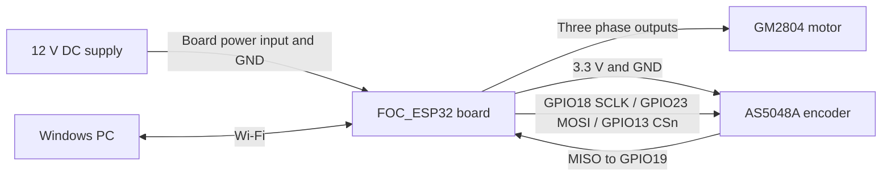

# Hardware and wiring

This is a module-level build using a purchased motor-driver board. The pin
map below comes from `PlatterDeck_FOC/src/config.h`; connector orientation
must be checked against the actual board. A board photograph and an annotated
connector drawing are still needed to complete the assembly instructions.

## Bill of materials

The editable [BOM.csv](BOM.csv) lists the components for one deck. Blank
price and supplier fields mean **not yet confirmed**, not zero cost.
The Windows PC and audio output are supporting equipment, not included in a
deck cost total. No total is claimed until the missing prices are entered.

| Qty | Item | Specification / remaining detail |
|---:|---|---|
| 1 | FOC controller board | ESP32-WROOM-32E, FOC_ESP32 / 303FOCESP01 / LCT-279; confirm PCB revision and purchase link |
| 1 | Gimbal motor | iPower GM2804, 7 pole pairs; confirm exact purchased variant |
| 1 | Encoder assembly | AS5048A SPI and shaft magnet; may already be included with motor |
| 1 | Supply | 12 V DC; confirm current rating, connector and polarity |
| 1 | Platter | Record diameter, thickness, material, mass and surface |
| 1 set | Platter attachment and base | Record the actual working mount, spacers and fastener sizes |
| 1 set | Wiring | Three motor phases, encoder signals/power and supply leads |
| 1 set | Programming interface | USB data cable and, if needed, a 3.3 V logic USB-to-UART adapter; confirm board interface |

Do not order a second encoder if the motor already includes it. The AS5048B
I2C variant is not a drop-in replacement for this AS5048A SPI firmware.

## Connections

| Encoder connection | ESP32 GPIO / rail |
|---|---:|
| SCLK | 18 |
| MISO (encoder data out) | 19 |
| MOSI (encoder data in) | 23 |
| CSn | 13 |
| Encoder power | 3.3 V |
| Encoder ground | Common GND |

Use the board's three motor-phase terminals for the motor. The following
signals are internal connections to the onboard driver, not motor power pins:

| Driver signal | ESP32 GPIO |
|---|---:|
| PWM A / B / C | 16 / 17 / 5 |
| Bridge enable | 4 |

**GPIO5 is phase-C PWM; encoder CSn is GPIO13.** Verify signal names rather
than assuming a connector's left-to-right order. Keep 12 V on the board's
power input, away from the encoder and ESP32 signal pins.

## First power-up

Wire with power disconnected, secure the stationary motor housing and make
sure the rotor can turn freely. Use a current-limited 12 V bench supply for
initial setup. The firmware uses voltage-mode FOC with current sensing disabled;
its current-limit setting does not provide measured current regulation.

Fresh firmware defaults to a **0.5 V motor voltage limit**. Existing NVS
settings can override that, and the deck/calibration CLI uses a 1.0 V torque
request. These are motor-drive settings, not the 12 V supply voltage.

Follow the [setup guide](../docs/getting-started.md) for encoder verification
and FOC calibration before playback. Changing the motor, magnet alignment or
platter can require repeating calibration and cogging identification.

## Mechanical details still required

Document the actual working v1 assembly: platter dimensions and mass, hub
attachment, motor mounting, screw sizes/engagement, base and cable routing.
Existing frame CAD is provisional, including the PCB hole spacing. Physical
fit and strength have not been established, so it is not a validated build file.
